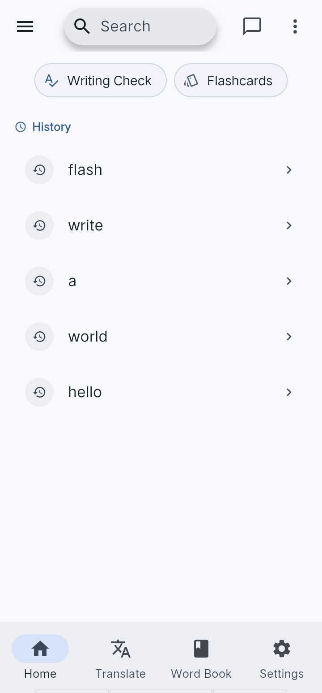
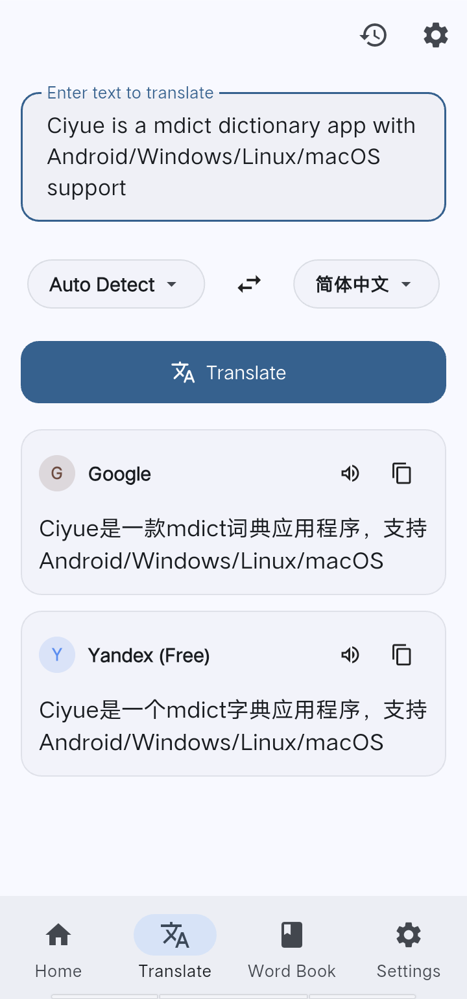
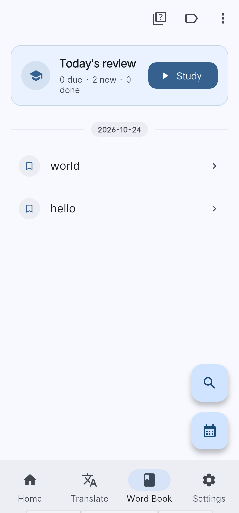
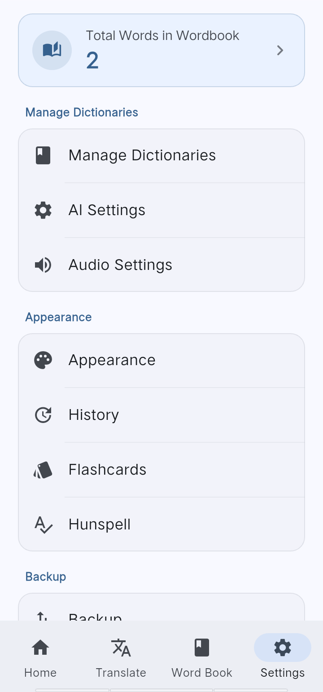

# Ciyue

[](https://github.com/mumu-lhl/Ciyue/releases/latest)
[](https://github.com/mumu-lhl/Ciyue/releases/latest)
[](https://f-droid.org/packages/org.eu.mumulhl.ciyue/)
[](https://hosted.weblate.org/engage/ciyue/)

[English](./README.md) | [中文](./README_CN.md) | Türkçe

MDX/MDD, StarDict ve ZIM sözlüklerini destekleyen Android, Windows, Linux ve macOS için bir sözlük uygulaması.

## Özellikler

* MDX/MDD, StarDict ve ZIM sözlük desteği
* Birden fazla sözlükte aynı anda arama
* Sözlük içeriğinde tam metin arama
* Ücretsiz servisler ve yapay zeka sağlayıcıları (OpenAI, Gemini, DeepSeek ve daha fazlası) dahil çok kaynaklı çeviri
* Özel istemlerle (prompt) yapay zeka sohbeti
* Yapılandırılmış yapay zeka kelime açıklamaları
* Tekrar testleriyle kelime defteri ve hata defteri
* FSRS aralıklı tekrarlı bilgi kartları (flashcards)
* Yapay zeka yazım denetimi
* Telaffuz paketleri, çevrimiçi telaffuz (Wiktionary, Forvo) ve metinden sese (TTS) ile sesli okuma
* Ayarlar, kelime defteri ve geçmiş için bulut eşitleme (WebDAV, S3, SFTP)
* Her yerde kelime aramak için yüzen pencere
* Material You tasarımı

## Ekran Görüntüleri

|  |  |  |  |  |
|-|-|-|-|-|

## Kurulum

[](https://repology.org/project/ciyue/versions)

[](https://github.com/mumu-lhl/Ciyue/releases/latest)
[](https://f-droid.org/packages/org.eu.mumulhl.ciyue/)
[](https://apps.obtainium.imranr.dev/redirect?r=obtainium://add/https://github.com/mumu-lhl/Ciyue)

### Arch Linux

Ciyue'yi tercih ettiğiniz [AUR yardımcıları](https://wiki.archlinux.org/title/AUR_helpers) aracılığıyla [AUR](https://aur.archlinux.org/packages/ciyue) veya [archlinuxcn](https://github.com/archlinuxcn/repo/tree/master/archlinuxcn/ciyue) deposundan kurabilirsiniz.

```bash
yay -S ciyue
```

### AppImage

- [AppMan](https://github.com/ivan-hc/AppMan) ile kurulum (root yetkisi gerektirmez)

  ```bash
  appman -i ciyue
  ```
- [AM](https://github.com/ivan-hc/AM) ile kurulum

  ```bash
  am -i ciyue
  ```

### Flatpak

Bir sürümden `ciyue-x86_64.flatpak` dosyasını indirin ve şu komutla kurun:

```bash
flatpak install --user ./ciyue-x86_64.flatpak
```

## Önerilen Sözlükler

[Wiki](https://github.com/mumu-lhl/Ciyue/wiki#recommended-dictionaries) sayfasına bakın.

## İzinler

### INTERNET (İnternet)

Ciyue, bir sözlükteki kelimeleri görüntülemek için WebView kullanır ve WebView yerel verileri görüntülerken bile çalışmak için INTERNET iznine ihtiyaç duyar.

Güncellemeleri kontrol ederken veya üçüncü taraf servislere (örneğin Yapay Zeka Sağlayıcısı) istek gönderirken Ciyue bu izni kullanır. Ciyue kendi başına bağımsız istekler başlatmaz.

## Discord

Toplulukla bağlantı kurmak için [Discord sunucumuza katılın](https://discord.gg/BazBZuvKZG)!

QQ Grubu: `1057888678`

## Çeviri

Dil eklemek veya çevirileri doldurmak için [Weblate](https://hosted.weblate.org/engage/ciyue/) adresini ziyaret edebilirsiniz.

[](https://hosted.weblate.org/engage/ciyue/)

## Sponsorlar

Ciyue'nin geliştirilmesini destekledikleri için sponsorluklarına teşekkür ederiz!

[Afdian](https://afdian.com/a/mumulhl), [Unifans](https://app.unifans.io/c/mumulhl) (Küresel) veya WeChat QR kodu üzerinden bağış yapabilirsiniz:


||
|-|
|The Blank Peiming|
|爱发电用户_c3f76|
|爱发电用户_8267c|
|蕬縌玢沰|
|爱发电用户_1b0db|
|爱发电用户_nW9j|

## Katkıda Bulunma

Bu projeye nasıl katkıda bulunacağınıza dair yönergeler için [CONTRIBUTING.md](./CONTRIBUTING.md) dosyasına bakın.

## Katkıda Bulunanlar

[](https://github.com/mumu-lhl/Ciyue/graphs/contributors)

## Hizmet Şartları

[Hizmet Şartları](./TERMS_OF_SERVICE.md)

## Gizlilik Politikası

[Gizlilik Politikası](./PRIVACY_POLICY.md)

## Sorumluluk Reddi

Ciyue'yi kullanarak, Ciyue'nin bakımcılarının ve katkıda bulunanlarının Ciyue'nin kullanımından doğan doğrudan veya dolaylı hiçbir kayıp, sorun veya olumsuz sonuçtan sorumlu olmadığını kabul ve beyan etmiş olursunuz. Bu yazılım "olduğu gibi" sağlanmaktadır ve kullanıcılar kullanımından doğan tüm riskleri üstlenir.

## Lisans

[MIT](./LICENSE)
